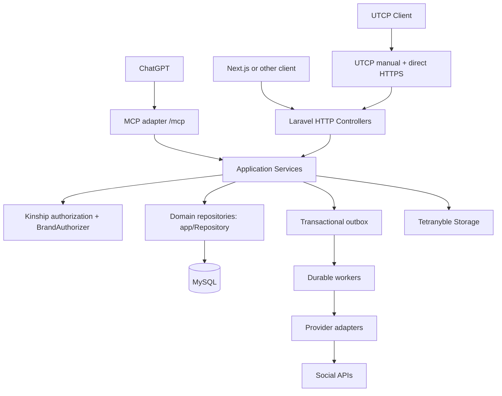

# Architecture, modules and ownership

## Architectural style

Laravel modular monolith + isolated, horizontally scalable queue workers. MySQL 8.x is the transactional source of truth. Redis is optional for queue/cache/rate-limit acceleration, **not** the only durable scheduler. Use database-backed outbox + idempotency. Tetranyble Storage owns physical media. Kinship owns permissions and role grants. REST is authoritative application boundary; UTCP publishes curated REST tool metadata; MCP is a thin ChatGPT compatibility adapter using the **same application services**.

## Logical request path

Do not deploy MCP or UTCP adapters as bypasses around authorization, approval or durable job orchestration. The current design supports `/mcp` in the same Laravel application where viable, but implementation must conform to verified installed MCP library specifications and ChatGPT connector availability.

## Module boundaries and primary record groups

| Module | Owns / interacts with | Does not own |
|---|---|---|
| Identity & organisations | organisations, memberships, preferences, context, subscription/policy assumptions | Kinship role/permission schemas |
| Brands & knowledge | brands, brand profile, segment/voice/claims/evidence/approval policies | social provider tokens |
| Social connectors | provider connections, social accounts, capabilities, account status and token lifecycle | campaign decisions |
| Media | marketing media references, usage in content, transformation requirements | canonical storage bytes/derivatives managed by Tetranyble Storage |
| Campaigns & content | campaigns, goals, labels, series, content items, immutable content versions, social targets | approval decisions |
| Approvals | approval requests, decisions, policy evaluation, payload hashes | physical provider publishing |
| Publisher | publication jobs/attempts/events/published posts, recurring schedules | editing approved content |
| Automation & AI | rule versions, automation runs, AI runs/checkpoints/tool attempts/approvals/model usage | unrestricted authority to publish |
| Growth | leads/contacts, consent, suppression, outreach, bookings, UTM and conversion events | student personal data |
| Analytics & ops | analytics, rollups, webhook/outbox, logs, limits, audit, notifications, retention | raw uncontrolled external API payload semantics |
| External tools | API resources, UTCP discovery, MCP tools and delegated credentials | domain logic or independent ACL definitions |

## Internal layer dependency rule

`Controller/MCP/UTCP/CLI/Job -> FormRequest/Command DTO -> Application Service -> Authorizer/Domain Policy -> Contract Repository -> Eloquent Repository -> Model/DB`.

- External webhook handlers validate signatures and store deduplicated raw events, then queue domain handlers; never grant rights from webhook payload fields.
- Queue job classes orchestrate persisted work and call services/repositories; never scatter business rules across Job `handle()` methods.
- Published content requires approved **exact payload hash/version**, capable connected account, storage readiness and a durable job ID.
- Provider integrations implement a strict adapter interface and normalize results; provider-specific status and raw request/response data must remain scoped and redacted.
- AI agents can propose plans/drafts and submit them for approval; externally visible side effects require explicit policy evaluation.

## Global cross-cutting requirements

1. Every brand-scoped query and mutation receives an **authorised organisation ID and brand ID** from execution context. Never infer authorization from a user-supplied route parameter.
2. Immutable business history for approvals, content versions, provider attempts, AI tool invocations and audit logs.
3. State transitions validated atomically with optimistic locking/version checks where useful.
4. Use jobs/outbox after database commit; reconcile uncertain external API outcomes before retrying.
5. Do not use destructive cascading deletes for material business audit trails; use data-retention and account-closure workflows.
6. Visibility and monitoring are first-class: structured logs, correlation IDs, queue backlog, provider errors, tool/approval latency, conversion events.

## Existing code that must be preserved or reconciled

- Reuse `App\Authorization\CurrentOrganisation`, `BrandAuthorizer`, and membership services; verify correctness with real Kinship/Storage package versions.
- Preserve British `Organisation` naming in the PHP project; do not alternate `Organization` in new class/table names without a formal rename migration.
- Treat `app/Repository/Contracts/Persistence.php` and `BaseRepository.php` as legacy base contracts needing tenant safety review, **not** proof that inherited unscoped `all()` and `paginate()` are safe.
- Do not introduce an unrelated repository directory: `app/Repository/Contracts` and `app/Repository/Eloquent` are the required locations.
