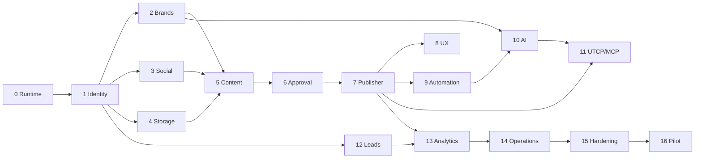

# Full implementation roadmap (source-aligned)

**Tracking rule:** a phase is complete only when code, migration verification, unit tests, feature tests, integration tests, API documentation, security checks, and deployment evidence are completed. Record proof in `PHASE_TRACKER.csv` and `09_HANDOFF_AND_PROGRESS.md`. Build vertically usable slices, not all models first and testing later. All stages below are **NOT STARTED** unless the tracker explicitly says otherwise.

## Phase 0 — Runtime baseline and remediation (blocking)

**Goal:** make the supplied Laravel source a dependable starting point.

1. Verify PHP/composer extension prerequisites and install exact `composer.lock` dependencies.
2. Create disposable MySQL 8.x test DB; inspect package migrations and their execution order; run fresh/up/down/rollback/refresh exercises.
3. Verify actual Kinship Workspace/WorkspaceSubject contracts, scoped role grant/revoke behavior, switch-user/organisation cache isolation; confirm permissions seeded and no global bypass.
4. Verify actual Storage host user/workspace contracts, migration tables, media canonical IDs, upload/get/authorise/delete and quota behavior; keep package public routes disabled until access tests pass.
5. Fix `UserRepository::save` contract anomaly; decide how `Persistence` and `BaseRepository` avoid unscoped access. Enforce repository contract bindings and create repository test conventions.
6. Verify tenant-composite FKs, indexed lookup plans, UUID defaults, generated MySQL columns, foreign key names, the fixed rollback names, package migration dependencies and the `SUSPENDED` repair.
7. Formalise `.env.testing`/CI DB isolation; document fixture factories, queue strategy and test suites; enable skipped relevant tests after repair.
8. Run all existing and new unit/feature/package integration tests; triage failures; keep a reproducible issue list.

**Acceptance:** All fresh + rollback schema tests pass; package contracts work in actual runtime; two organisations and two brands cannot leak; no direct unscoped repository access in new services. **No social publishing or MCP write tools until this gate passes.**

## Phase 1 — Identity, organisation onboarding, membership and authorization

1. Auth/login/token/session and API guard strategy; rate limits, impersonation restrictions, account lockout where required.
2. Organisation create/update/suspend/close lifecycle; initial owner bootstrap only after verified creator identity; conflict and repeat-create tests.
3. Organisation preferences, membership invitations/grants/revocation and membership status; Kinship role workspace binding, explicit permission catalogue, role assignment synchronization.
4. Brand authorization as organisation Kinship permission **AND** active brand membership (not either); prevent cross-brand read/write and audit access.
5. Repository contracts + Eloquent classes for organisation/member/brand access. Build FormRequests, Resources, pagination/filters, audit logs.
6. Initial API endpoints with versioning and stable error envelope. Controller/service/repo separation; API specs.

**Tests:** malformed tenant context; revoked member during queued job; role from another workspace; concurrent bootstrap; disabled organisation; id spoofing; service contract mocks; MySQL FK/transaction tests. **Exit:** tenant-safe onboarding and access APIs.

## Phase 2 — Brands, targeting, positioning, claims and governance

1. Brand CRUD and brand-specific profiles; audience segment/role/location/pain point/goal records; hierarchical country/state/city valid combinations and all-country targeting semantics.
2. Brand voice rules, preferred/prohibited terms, example library; approved claims, evidence, restrictions, disclaimers and expiry; ensure agent cannot invent claims from missing evidence.
3. Approval policy/rules/versioning for content kinds/provider accounts; immutable activated policies; minimum approvers, four-eyes rule, different-role approval.
4. Knowledge sources: ingest authorized public docs with provenance, freshness, visibility and explicit human approval.
5. Repository contracts and tests across full brand hierarchy; resource responses expose typed data, not opaque JSON configuration.

**Tests:** two brands with identical labels remain isolated; invalid location hierarchy rejected; stale claims blocked; self-approval denied; policy version audit. **Exit:** a brand can express valid audiences and publishing governance.

## Phase 3 — Provider connections and social accounts

1. Define adapter interface/capability matrix; OAuth credential lifecycle (scopes, encrypted references, refresh, revoke, state/nonce/PKCE where provider supports).
2. Provider connections (credential owner + org scope); linked pages/channels/profiles + brand association; account capability discovery and refresh.
3. Provider-specific connection statuses, token expiry, retry policies, provider rate limits, sandbox fixtures and webhook handshake verification.
4. Implement initial **Facebook Pages + YouTube** eligible workflows based on actual approved provider APIs; model TikTok as assistance/handoff unless required access/audit is granted. Add Instagram/LinkedIn only after capability checks.
5. Per-account connection review UI/API with credential redaction; audit every privileged change.

**Tests:** OAuth replay/mismatched state, revoked token, expired permissions, wrong tenant, API 401/403/429/5xx, lost refresh race; no token leakage. **Exit:** account discovery and read-only capabilities proven without live publishing.

## Phase 4 — Storage and creative asset management

1. Integrate Tetranyble Storage as canonical owner of media, including upload/resumable flow, content type/size checks, private/public placement, workspace isolation, quota and malware scanning options.
2. Confirm Storage media key and introduce verified FK or rigorous package-owned lookup strategy for `media_assets.storage_media_id`; avoid duplicate media metadata and clean legacy fields with forward migrations.
3. Brand usage records, accessibility/alt text, campaign content references; generate media previews only through package mechanisms where supported.
4. Video readiness pipeline (duration/aspect/codec checks, transcoding if needed), safe upload finalization and orphan/retry cleanup.

**Tests:** spoofed MIME, oversized upload, malicious paths, cancellation, duplicate upload, cross-org media access, missing media reference, storage unavailable. **Exit:** publishable and provenance-backed assets.

## Phase 5 — Campaigns, content and platform targeting

1. Campaigns/goals, objective, dates, lifecycle; repository + service + HTTP resources.
2. Content items, reusable series, labels, media links, immutable `content_versions`, `content_targets` with platform-specific caption/format/metadata and checksums.
3. Content drafting/editing/duplication/archive; content validation per social capability; content calendar read APIs and timezone presentation.
4. Scheduling candidates (not yet external publish), preview views, revision history, content provenance and source claim checks.

**Tests:** duplicate content version, stale revision update, cross-brand media link, unsupported aspect/media type, invalid character limits, 429 from provider metadata lookup. **Exit:** complete author-to-review workflow without publishing.

## Phase 6 — Approval and scheduling workflow

1. Approval requests/decisions and exact payload/version/hash binding; concurrent approvals and separation-of-duties logic.
2. Rules by brand/provider/action; approval expiration, withdrawal, rejection, policy changes, content editing invalidates approval.
3. Create `publication_jobs` only from current approved target; enforce occurrence uniqueness, recipient account state, queued scheduling window and actor permissions.
4. Implement cancellation/edit rescheduling, notification dispatch and calendar drilldown.

**Tests:** self-approval, insufficient approvals, approved then edited, policy changed mid-run, concurrent approvals, unauthorized schedule, expired approval, duplicate occurrence. **Exit:** deterministic approved scheduling persisted.

## Phase 7 — Durable publisher and provider execution

1. MySQL durable queue/lease selection with row locks and recovery; transactional outbox writes and after-commit enqueue.
2. Publishing state machine: scheduled -> leased -> publishing -> published / retry-wait / uncertain / terminal-failed / cancelled, with provider async processing states as needed.
3. Adapter execution with provider-specific idempotency/reconciliation; never blindly retry uncertain calls. Record attempts, external post IDs, events, cost/quota and error taxonomy.
4. Retry/backoff with jitter, bounded attempts, lease expiry, worker heartbeats, provider rate limits and circuit protection.
5. Failed job alerting, manual reconciliation/force review, visibility into time zones and schedule execution; run 2+ concurrent workers.

**Tests:** two claimants one job, crash before external API, crash after provider succeeds, timeout-after-acceptance, 429 Retry-After, 500 retry, duplicate webhook, expired token while processing, outbox relay failure. **Exit:** one authorised business publication outcome or explicit uncertain reconciliation, never silent duplicates.

## Phase 8 — Calendar, publisher dashboard and notification experience

1. Brand/campaign/filterable calendar and schedule status; account connect health, approvals inbox, failures/retry panel.
2. User-facing notifications, contact preferences and in-app activity; email via configured mail transport where justified.
3. Accessible, keyboard-usable UI with pagination, optimistic UI only for reversible actions, proper server-state reconciliation and error/empty/loading states.
4. RBAC-aware controls and external-write confirmations, no cross-brand client caching.

**Tests:** browser E2E draft/approve/schedule, unauthorized button+server, daylight saving schedule, stale UI update, upload failure, notify dedup. **Exit:** humans can safely operate publishing end to end.

## Phase 9 — Automation rules and orchestration

1. Define schema/versioned trigger + condition + action model, with explicit typed records for known executable rules; no unbounded arbitrary JSON interpretation.
2. Rule draft/validate/simulate/publish/pause; immutable active version and deterministic evaluation.
3. Trigger inbox dedupe; durable automation runs; retry, compensation, per-brand rate/budget limits and safeguards against recursive workflow loops.
4. Scheduler for recurring content and approved schedules; event-based workflows for new leads/conversions and failed publications.

**Tests:** duplicated trigger, loop detection, malformed rule, time window boundaries, retry after crash, policy update, privilege escalation, service restart. **Exit:** auditable rules execute predictably without bypassing approvals.

## Phase 10 — AI agent and brand intelligence

1. Brand-aware prompt/knowledge assembly with content grounding, source/claim citations and deterministic policy validation.
2. AI research and content suggestions; structured output validation, prompt injection defense, model cost ledger, budgets, tenant-scoped sources.
3. Durable `ai_runs`, checkpoints, tool executions/attempts, human approvals, cancel/resume/steer workflows; provider model abstraction and fallback.
4. Content auto-drafts, suggested calendar, ad copy, topic classification, performance recommendations; no unsanctioned posts.
5. Scheduled weekly reports of research and recommended drafts; optionally user-controlled automation.

**Tests:** invalid structured AI output, hallucinated claim blocked, tool permission denial, prompt injection in documents/web results, timeout/cancel/restart/replay, budget exceeded, cross-brand data leak, two agents same job. **Exit:** AI produces useful reviewed marketing plans and drafts reliably.

## Phase 11 — UTCP and MCP for ChatGPT

1. Publish vetted UTCP discovery definitions mapped to versioned REST endpoints; transport/auth schemas validated, only tools actually implemented.
2. Implement Laravel-hosted MCP compatibility adapter exposing granular read/draft/approval/schedule/cancel/report tools; avoid duplicate domain service logic.
3. OAuth/delegated identity and brand-scoped capability grants; external-client revocation, token expiry, server-side input validation, audit, explicit approval gates.
4. Provide asynchronous long-running tool outcome APIs/job IDs; return precise success/pending/failure and never imply a remote post succeeded on enqueue.
5. Validate compatibility against the **current** ChatGPT supported custom connector/app setup, including account/workspace write restrictions; retain native AI UI as fallback.

**Tests:** tool discovery, schema matching, OAuth success/expiry/revocation, confused deputy, external tool attempts, no scope leak, duplicate tool request, response contains real IDs/state, adapter and REST parity. **Exit:** demonstrated authenticated read and approved write from a supported ChatGPT session to staging, with recorded evidence.

## Phase 12 — Leads, consent, outreach and CRM

1. Leads/contacts with provenance, dedup/merge, assigned owner and brand isolation; verified inbound demo/contact capture from Pensuh product site.
2. Consent records, opt-out/suppression enforcement and lawful outreach segmentation; no unsolicited automated blasts.
3. Outreach sequences, steps/enrollment, dispatches, templates, stop-on-reply/opt-out, safe throttling and approval of initial external contacts.
4. Booking calendar and follow-up reminders, attribution to lead and campaign where permissible, CRM integration boundaries.

**Tests:** suppression always wins, revocation between queue/sending, duplicate lead, missing consent, email provider timeout, Do-Not-Contact consistency, right-to-object request. **Exit:** auditable compliant lead-to-demo operations.

## Phase 13 — Tracking, attribution, analytics and reports

1. UTM/tracking links, conversion collector/signature keys, anonymous/consented attribution touch records; reconcile time zones and duplicate events.
2. Provider metrics ingestion via read-only APIs with rate-limit cursors, snapshot provenance and metric definition versions.
3. Analytical rollups for post/brand/campaign, funnel from impression/click to demo/pilot/subscription; avoid false cross-platform comparability.
4. Reports (weekly/monthly), scheduled exports, dashboard queries, cost caps and success metrics.

**Tests:** duplicate conversion event, late-arriving data, lost cursor, metric schema evolution, report authorization, currency conversion methodology, reconciliation with provider fixture. **Exit:** business funnel and marketing outcomes demonstrably measurable.

## Phase 14 — Operational controls, billing readiness and data lifecycle

1. Admin APIs for audit logs, API logs/rate limits, usage ledgers and sync cursor health; quotas and cost alerts per org/brand.
2. Webhook inbox, idempotency retention, outbox recovery, dead-letter/error dashboards, notification preferences and tracing.
3. Export, deletion, retention/hold, account disconnection and closure workflows; encrypted secrets, backup restore drills, least-privilege operators.
4. Optional billing abstraction and external-customer onboarding only after internal platform acceptance.

**Tests:** retention exclusions/legal hold, audit immutability, restoration, rate-limit exhaustion, credential revocation, backup recovery, GDPR/NDPA-style request workflows as applicable. **Exit:** operations can diagnose, recover and govern the platform safely.

## Phase 15 — Security hardening, performance and provider review

1. Threat-model social OAuth, file upload, webhooks, tools, AI prompt injection, tenancy, billing and workers.
2. Abuse, SSRF, XSS, SQLi, credential leaks, CSRF/CORS, rate limits, insecure redirects, data lifecycle, admin break-glass policies.
3. Load/performance and indexing tests with realistic queues/assets; failover and multi-worker chaos tests; provider review/audit requirements.
4. Security remediation evidence, dependency audit, log privacy and alert runbooks.

**Tests:** automated negative suite + independent review where possible; staging load and failure injection evidence. **Exit:** all P0/P1 findings closed and performance/availability targets observed.

## Phase 16 — Pilot Pensuh, release, iterate, expand brands

1. Onboard Pensuh with accurate brand profile, approved verified claims, Facebook/TikTok/YouTube accounts to the extent provider permissions allow, content batch and approval workflow.
2. Staging E2E with media, retries, OAuth refresh and UTCP/MCP; launch phased low-risk production posting.
3. Record baseline metrics and weekly demos; campaign source and attribution link instrumentation; train operators and practice recovery.
4. Expand to FlymyMall and other brands only after isolation and billing/usage controls are demonstrably safe.
5. Maintain continuous iteration: provider API changes, support tickets, analytics feedback and regression test updates.

**Tests:** pilot release readiness, provider audit, rollback rehearsal, data-recovery drill, brand isolation under two live brands, post publication reconciliation. **Exit:** repeatable operating process for multiple brands.

## Dependencies and scheduling order

Lead acquisition and analytics can be developed as vertical slices in parallel once secure brand foundation is complete, but production launch remains gated on provider, consent, publishing and operational safety.

## Work item protocol (apply to every subtask)

- Ticket ID + domain and acceptance cases, including negative cases.
- Determine tenant scope, repository contract and service method; check existing package first.
- Write unit test for policy/service with repository mocks, feature request test, MySQL integration test for persistence; add provider contract/e2e if touched.
- Implement migration (forward-only for deployed databases), model/factory, repository contract/impl/binding, policy/service, request/resource/controller/routes/adapter, events/jobs.
- Run targeted tests immediately; fix; run full relevant suite and lint/format/static checks; update schema/API docs and operational logs.
- Review authorization, idempotency, concurrency, observability, rollback and secrets handling.
- Update tracker and `CONTINUE_HERE.md` with verified evidence, then merge.
