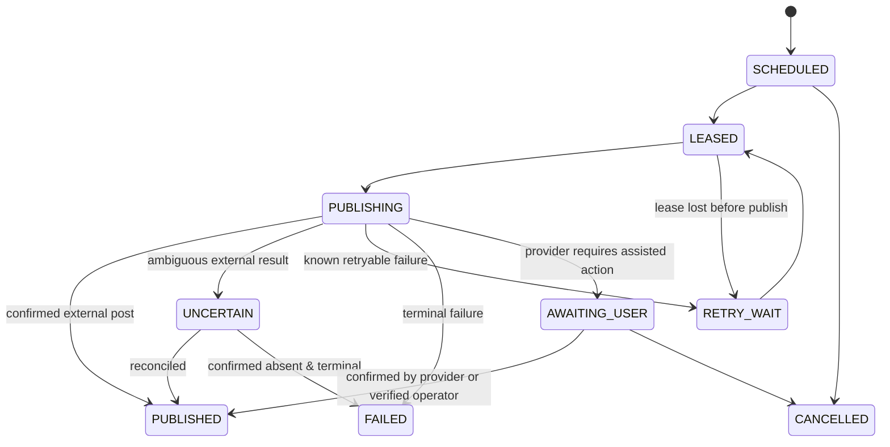

# Business state machines and invariants

**Authoritative enum values below were observed in `app/Enums` of the supplied Laravel source, but the permitted transitions are *proposed requirements* to implement and test.** No service-level transition implementation has been verified.

## Content and campaign lifecycle

- `CampaignStatus`: `DRAFT`, `ACTIVE`, `PAUSED`, `COMPLETED`, `ARCHIVED`.
- `ContentItemState`: `DRAFT`, `ACTIVE`, `ARCHIVED`.
- `MediaAssetState`: `UPLOADED`, `PROCESSING`, `READY`, `REJECTED`, `DELETED`.
- Define allowed forward transitions in a domain policy; archive must preserve history. Edits to referenced published target create a new version, not mutation.

## Approvals

- `ApprovalRequestStatus`: `PENDING`, `APPROVED`, `REJECTED`, `WITHDRAWN`, `EXPIRED`.
- Proposed: create -> pending; pending -> approved only after required distinct authorized approvers; pending -> rejected/withdrawn/expired; no direct approved -> pending transition. New revision generates a new request.
- `ApprovalDecision`: `PENDING`, `APPROVE`, `REJECT`. A decision is attributable to an authenticated human principal and exact policy revision.

## Publishing

`PublicationJobState`: `SCHEDULED`, `LEASED`, `PUBLISHING`, `AWAITING_USER`, `RETRY_WAIT`, `UNCERTAIN`, `PUBLISHED`, `FAILED`, `CANCELLED`.

A precise transition map must define how `UNCERTAIN` is reconciled to retry only when safe, and what outcome is valid for assisted publishing without a provider confirmation. Never count unknown outcome as published.

## AI and automation

- `AiRunStatus`: `QUEUED`, `RUNNING`, `WAITING_APPROVAL`, `WAITING_INPUT`, `COMPLETED`, `FAILED`, `CANCELLED`.
- `AiToolExecutionStatus`: `PENDING`, `RUNNING`, `WAITING_APPROVAL`, `COMPLETED`, `FAILED`, `CANCELLED`, `UNCERTAIN`.
- `AutomationRuleStatus`: `DRAFT`, `ENABLED`, `PAUSED`, `RETIRED`.
- `AutomationRunStatus`: `QUEUED`, `RUNNING`, `WAITING_APPROVAL`, `COMPLETED`, `FAILED`, `CANCELLED`.
- Resume must use persisted checkpoint and checked tool idempotency; no repeat external action just because a process restarted.
- Approval wait requires a real human decision; model text is not a substitute.

## Leads and outreach

- `LeadStatus`: `NEW`, `QUALIFYING`, `QUALIFIED`, `DEMO`, `TRIAL`, `WON`, `LOST`, `DISQUALIFIED`.
- `ConsentState`: `GRANTED`, `WITHDRAWN`, `OBJECTED`; send-time checks must respect withdrawal/objection and suppression independent of stale enrollment state.
- `OutreachDispatchState`: `PENDING_APPROVAL`, `APPROVED`, `SENDING`, `SENT`, `FAILED`, `CANCELLED`, `SUPPRESSED`.
- `DemoBookingStatus`: `BOOKED`, `ATTENDED`, `NO_SHOW`, `CANCELLED`.
- A failed or suppressed outreach must never falsely advance lead conversion metrics.

## Concurrency rules applying to all lifecycles

- A service reads the current persisted state and expected version (optimistic lock) or acquires an appropriate row lock; applies one validated transition; writes audit/outbox atomically.
- No transition directly from HTTP controller, CLI or MCP adapter; service/repository contract only.
- Test invalid transitions as well as happy path, including simultaneous requests and retries.
- State names are not necessarily provider names; adapters translate external provider states into internal statuses with provenance.
